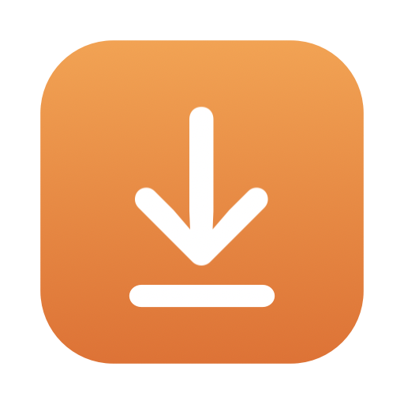

<p align="center"></p>

<h1 align="center">DiskLoader</h1>
<p align="center">Скачивание файлов и папок напрямую по ссылке с облачных дисков.</p>

---

Вставил ссылку — видишь, что внутри — выбрал нужное — скачал. Без браузера, аккаунтов и лишних окон.

- папки целиком или отдельные файлы, структура сохраняется
- большие файлы качаются в несколько потоков
- пауза и докачка с того же места, даже после перезапуска
- очередь из нескольких ссылок
- история загрузок
- обновляется само

## Скачать

**macOS 14+** · Apple Silicon и Intel → [последняя версия](../../releases/latest)

1. Открой `DiskLoader-<версия>.dmg` и перетащи DiskLoader в «Программы».
2. Первый запуск: **Системные настройки → Конфиденциальность и безопасность → Всё равно открыть** (приложение не подписано сертификатом Apple).

Windows — позже.

## Сборка

```
./build.sh            # собрать и поставить в /Applications
./build.sh release    # + dist/*.dmg и *.zip для релиза
```

DMG собирается через [dmgbuild](https://github.com/dmgbuild/dmgbuild): `pip install dmgbuild` в `~/.venvs/dmgbuild`.

---

<p align="center"><sub>made by <a href="https://t.me/cetrovix">cetrovix</a></sub></p>
